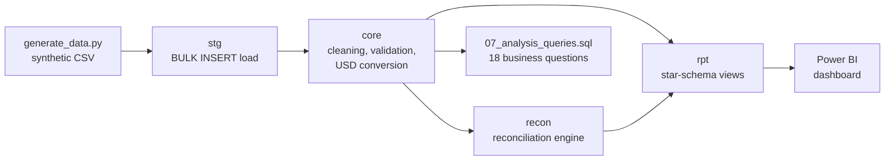
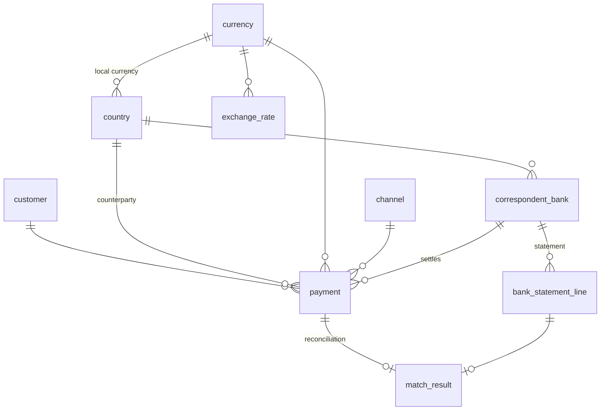
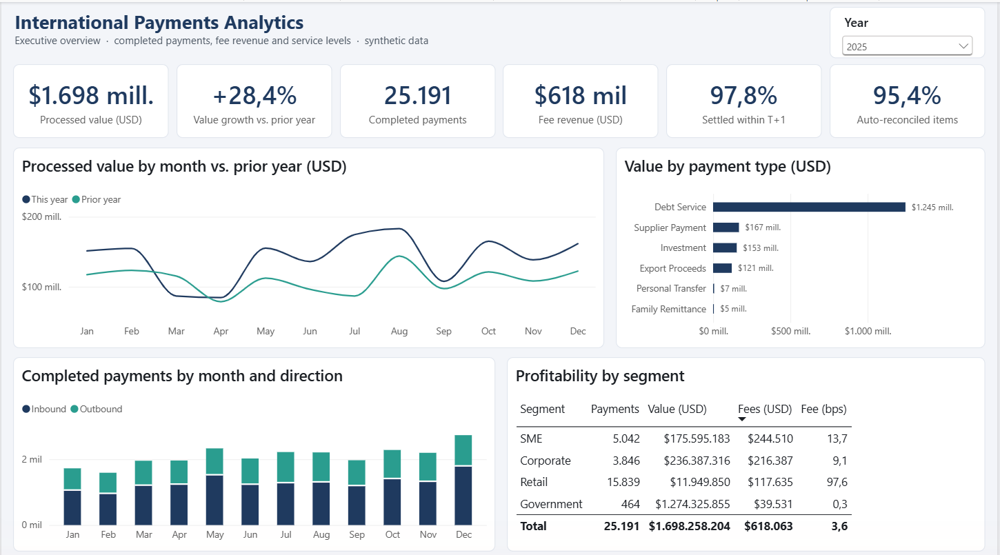
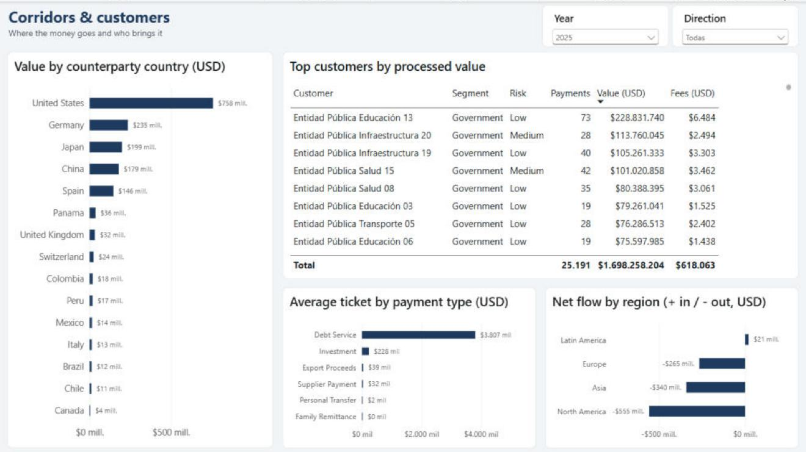
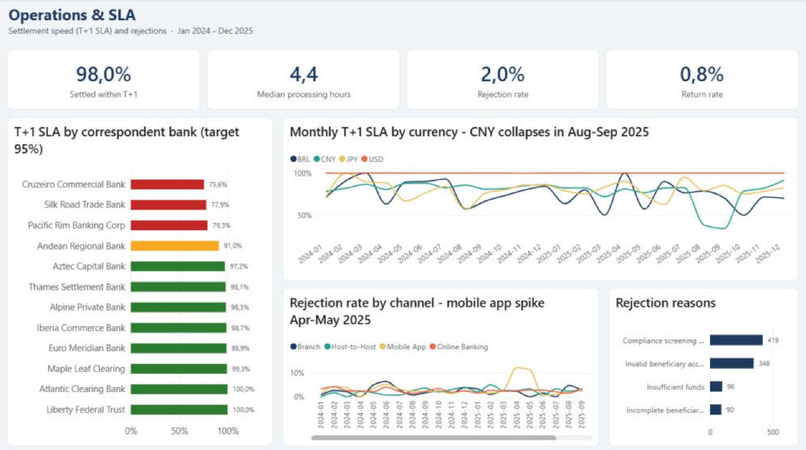
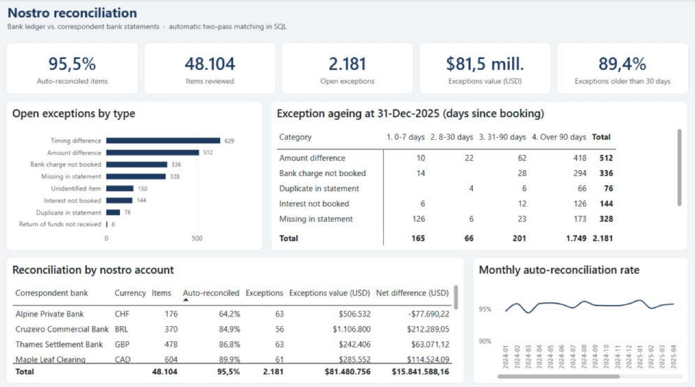
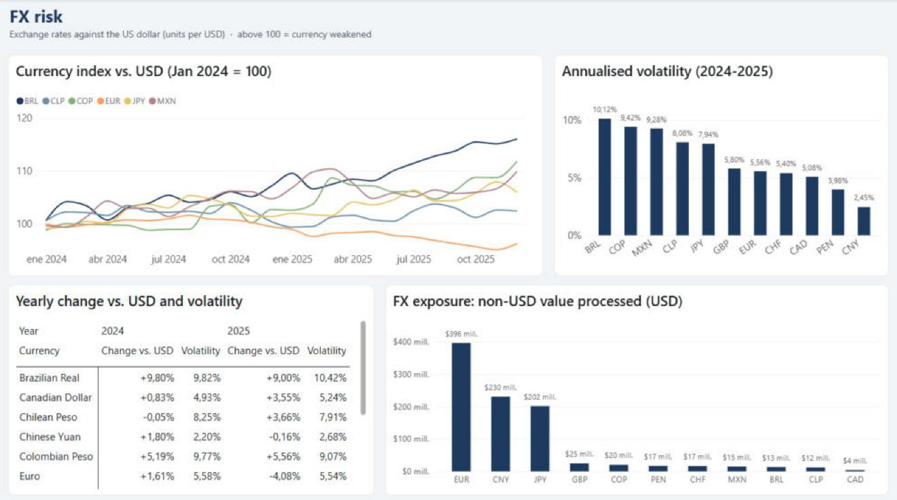

# 💱 International Payments Analytics

**SQL Server · T-SQL · Power BI · Python** — 🇪🇸 [Versión en español](README.md)

End-to-end analysis of the international payments of a fictitious bank in Ecuador: data loading and cleaning, automatic reconciliation against correspondent banks, business analysis in SQL and a Power BI dashboard.


---

## 🎯 Business problem

A bank sends and receives cross-border transfers (remittances, supplier payments, debt service, investments) through **12 correspondent banks** in **12 currencies**. Business and operations teams need to answer:

1. How are volume, value and fee revenue growing?
2. Which corridors, segments and customers drive the business, and which are the most profitable?
3. Is the settlement SLA (T+1) being met? Which correspondent or currency fails, and when?
4. Why are payments rejected, and through which channel?
5. Does every payment show up on the correspondent's statement? Which items remain open, and for how long?

## 🏗️ Architecture



| Layer | What it does |
|---|---|
| `stg` | Receives the CSV files as they are (everything as text) so no row is lost |
| `core` | Fixes spacing and casing, removes duplicates and test records, converts to USD with the daily FX rate and enforces keys and rules (`CHECK`, `FK`) |
| `recon` | Stored procedure that reconciles payments vs. statements in two passes and classifies every difference |
| `rpt` | Star-schema views; business rules (SLA, ageing, net flow) live here instead of being repeated in DAX |

## 🗂️ Data model



Every column is described in the [data dictionary](docs/data_dictionary.md).

## 📊 Key findings

| # | Finding | Query |
|---|---|---|
| 1 | **Solid growth:** in 2025 completed payments grew **+17.7%** (21.4k → 25.2k), processed value **+28%** (USD 1.32 → 1.70 billion) and fee revenue **+14.6%** (USD 539k → 618k). | Q1, Q2 |
| 2 | **Concentration:** public-sector debt service is only 586 payments but **72% of the value**. The Ecuador → United States corridor holds **38.6%** of the value; United States → Ecuador has the most transactions (14k, mostly remittances). | Q3, Q16 |
| 3 | **Profitability by segment:** Retail pays an effective **99 bps** versus **9 bps** for Corporate and **0.3 bps** for Government: it brings **19% of fee revenue with less than 1% of the value**. | Q10 |
| 4 | **SLA alert:** the Chinese yuan (CNY) correspondent dropped to **38% and 34%** compliance in Aug–Sep 2025, against ~79% for its own 6-month average. USD settles 100% within T+1. | Q6, Q7 |
| 5 | **Mobile app incident:** the rejection rate jumped to **12.1% and 11.2%** in Apr–May 2025 (channel average: 3.2%) due to "incomplete beneficiary data", right when the app had reached **50%** of personal transfers. | Q8, Q9 |
| 6 | **Automatic reconciliation:** **95.5%** of 48,104 items are matched with no manual work (98 recovered by the amount + date rule). **2,181 exceptions worth USD 81.5 M** remain, classified by type and age. | 05, Q17, Q18 |
| 7 | **Data quality:** 46 rows excluded and logged (15 duplicated customers, 25 duplicated payments, 6 test records); 9 out of 9 critical checks pass. | 03, 04 |

## 🧠 SQL techniques shown

| Technique | Where |
|---|---|
| Layered design, keys, `CHECK` constraints, `PERSISTED` computed columns, indexes | [01_create_tables.sql](sql/01_create_tables.sql) |
| Dynamic `BULK INSERT` with a cursor and `sp_executesql` | [02_load_staging.sql](sql/02_load_staging.sql) |
| Text cleaning, `TRY_CONVERT`, de-duplication with `ROW_NUMBER`, `XACT_ABORT` transaction, recursive CTE calendar | [03_transform_core.sql](sql/03_transform_core.sql) |
| Automated data-quality checks | [04_data_quality.sql](sql/04_data_quality.sql) |
| Stored procedure, temp tables, `CROSS APPLY`, two-pass one-to-one matching | [05_reconciliation.sql](sql/05_reconciliation.sql) |
| Star-schema views, business-day logic | [06_reporting_views.sql](sql/06_reporting_views.sql) |
| `LAG`, window frames, `PERCENTILE_CONT`, `NTILE`, `DENSE_RANK`, `FIRST_VALUE/LAST_VALUE`, `ROLLUP`/`GROUPING`, `PIVOT`, cohort analysis, RFM, z-score | [07_analysis_queries.sql](sql/07_analysis_queries.sql) |

## 📈 Power BI dashboard

Power BI Project (`.pbip`) with a star-schema model, 41 DAX measures and 5 pages. How to open it and how it is built: [`powerbi/`](powerbi/README.md).



| Corridors & customers | Operations & SLA |
|---|---|
|  |  |
| **Reconciliation** | **FX risk** |
|  |  |

## ▶️ How to run it

**Requirements:** SQL Server 2019 or later (Express edition works), PowerShell 5.1+, Power BI Desktop. Python 3.10+ only if you want to regenerate the data.

```powershell
# 1. Build the whole database (~20 s)
.\scripts\build_database.ps1                      # default server: localhost
.\scripts\build_database.ps1 -Server "localhost\SQLEXPRESS"

# 2. (Optional) regenerate the CSV files and also run the analysis queries
.\scripts\build_database.ps1 -GenerateData -RunAnalysis
```

You can also open the `sql/` scripts in SSMS and run them in order (in `02_load_staging.sql`, set `@data_path` to the `data\raw\` folder).

## 📁 Structure

```
international-payments-analytics/
├── data/raw/              # 8 synthetic CSV files (~10 MB)
├── docs/                  # data dictionary and dashboard images
├── powerbi/               # Power BI project (.pbip): TMDL model, PBIR report, measures and theme
├── scripts/
│   ├── generate_data.py   # reproducible generator (seed 42, no dependencies)
│   └── build_database.ps1 # builds everything with one command
└── sql/
    ├── 00_create_database.sql
    ├── 01_create_tables.sql
    ├── 02_load_staging.sql
    ├── 03_transform_core.sql
    ├── 04_data_quality.sql
    ├── 05_reconciliation.sql
    ├── 06_reporting_views.sql
    └── 07_analysis_queries.sql
```

## ℹ️ About the data

All data is **synthetic**, created with [`generate_data.py`](scripts/generate_data.py): customers, banks, SWIFT codes and amounts are fictitious, and any resemblance to real entities is coincidental. The generator deliberately injects data-quality issues (spacing, casing, duplicates, test records) and two operational events (CNY correspondent delays and the mobile app failure) so the analysis has something real to discover.

---

👤 **Bryan Andrés Romo Arias** · [GitHub](https://github.com/BryanAndresR23) · [LinkedIn](https://www.linkedin.com/in/bryanromo)
