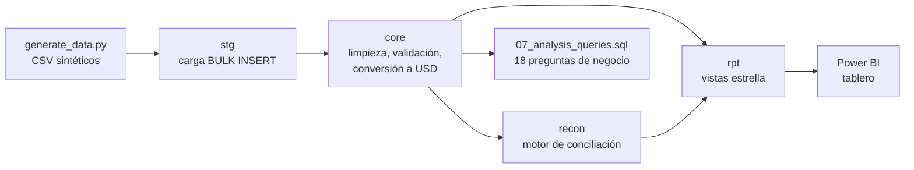
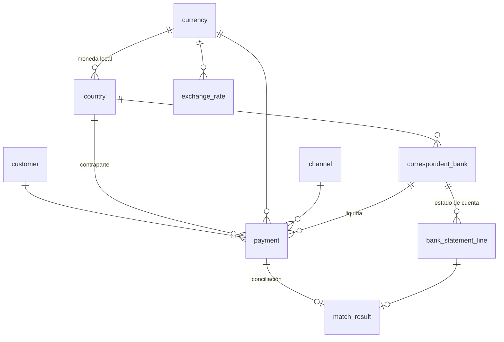
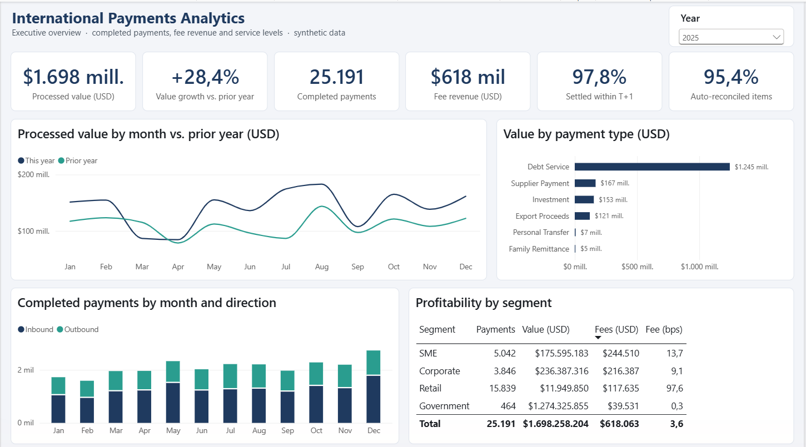
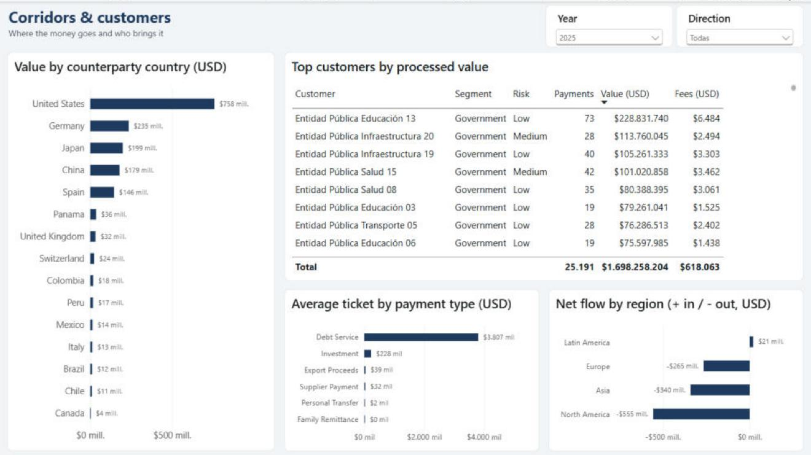
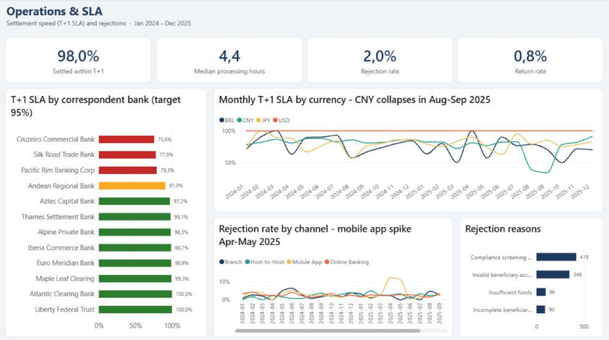
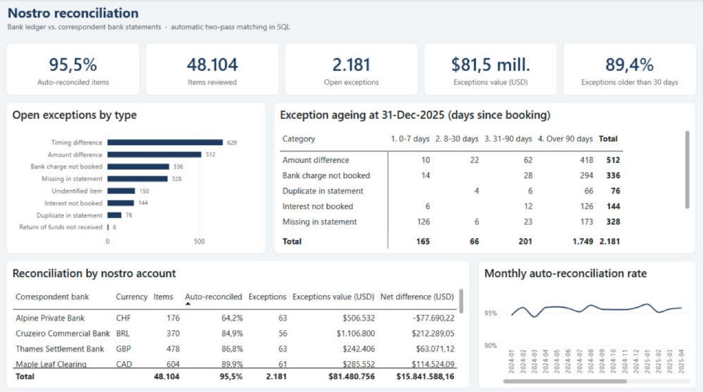
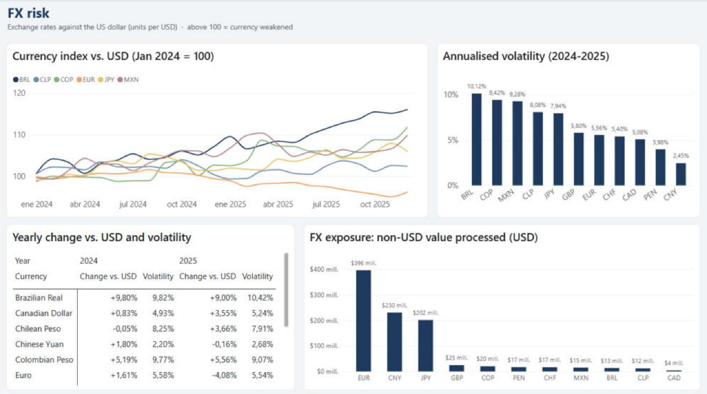

# 💱 International Payments Analytics

**SQL Server · T-SQL · Power BI · Python** — 🇬🇧 [English version](README.en.md)

Análisis de punta a punta de los pagos internacionales de un banco ficticio en Ecuador: carga y limpieza de datos, conciliación automática con los bancos corresponsales, análisis de negocio en SQL y un tablero en Power BI.


---

## 🎯 El problema de negocio

Un banco envía y recibe transferencias internacionales (remesas, pagos a proveedores, servicio de deuda, inversiones) a través de **12 bancos corresponsales** en **12 monedas**. Las áreas de negocio y operaciones necesitan responder:

1. ¿Cómo crecen el volumen, el valor y los ingresos por comisiones?
2. ¿Qué corredores, segmentos y clientes concentran el negocio y cuáles son más rentables?
3. ¿Se cumple el SLA de liquidación (T+1)? ¿Qué corresponsal o moneda falla y cuándo?
4. ¿Por qué se rechazan los pagos y en qué canal?
5. ¿Cada pago aparece en el estado de cuenta del corresponsal? ¿Qué partidas quedan abiertas y desde cuándo?

## 🏗️ Arquitectura



| Capa | Qué hace |
|---|---|
| `stg` | Recibe los CSV tal cual (todo como texto) para no perder ninguna fila |
| `core` | Limpia espacios y mayúsculas, elimina duplicados y registros de prueba, convierte a USD con el tipo de cambio del día y aplica claves y reglas (`CHECK`, `FK`) |
| `recon` | Procedimiento almacenado que concilia pagos vs. estados de cuenta en dos pasadas y clasifica cada diferencia |
| `rpt` | Vistas en esquema estrella; las reglas de negocio (SLA, antigüedad, flujo neto) viven aquí y no se repiten en DAX |

## 🗂️ Modelo de datos



Detalle de cada columna en el [diccionario de datos](docs/data_dictionary.md).

## 📊 Hallazgos principales

| # | Hallazgo | Consulta |
|---|---|---|
| 1 | **Crecimiento sólido:** en 2025 los pagos completados crecieron **+17.7%** (21.4k → 25.2k), el valor procesado **+28%** (USD 1.32 → 1.70 mil millones) y las comisiones **+14.6%** (USD 539k → 618k). | Q1, Q2 |
| 2 | **Concentración:** el servicio de deuda del sector público son solo 586 pagos pero el **72% del valor**. El corredor Ecuador → Estados Unidos concentra el **38.6%** del valor; Estados Unidos → Ecuador es el de más transacciones (14k, sobre todo remesas). | Q3, Q16 |
| 3 | **Rentabilidad por segmento:** Retail cobra **99 pb** efectivos frente a **9 pb** de Corporativo y **0.3 pb** de Gobierno: genera el **19% de las comisiones con menos del 1% del valor**. | Q10 |
| 4 | **Alerta de SLA:** el corresponsal de yuanes (CNY) cayó a **38% y 34%** de cumplimiento en ago–sep 2025, frente a ~79% de su promedio de 6 meses. USD liquida el 100% en T+1. | Q6, Q7 |
| 5 | **Incidente en la app móvil:** la tasa de rechazo subió a **12.1% y 11.2%** en abr–may 2025 (promedio del canal: 3.2%), por «datos incompletos del beneficiario», justo cuando la app ya era el **50%** de las transferencias personales. | Q8, Q9 |
| 6 | **Conciliación automática:** el **95.5%** de 48,104 partidas se cuadra sin intervención manual (98 recuperadas por la regla monto + fecha). Quedan **2,181 excepciones por USD 81.5 M**, clasificadas por tipo y antigüedad. | 05, Q17, Q18 |
| 7 | **Calidad de datos:** 46 filas excluidas y documentadas (15 clientes duplicados, 25 pagos duplicados, 6 registros de prueba); 9 de 9 controles críticos en verde. | 03, 04 |

## 🧠 Técnicas SQL que muestra el proyecto

| Técnica | Dónde |
|---|---|
| Diseño por capas, claves, `CHECK`, columnas calculadas `PERSISTED`, índices | [01_create_tables.sql](sql/01_create_tables.sql) |
| `BULK INSERT` dinámico con cursor y `sp_executesql` | [02_load_staging.sql](sql/02_load_staging.sql) |
| Limpieza de texto, `TRY_CONVERT`, deduplicación con `ROW_NUMBER`, transacción con `XACT_ABORT`, CTE recursiva para el calendario | [03_transform_core.sql](sql/03_transform_core.sql) |
| Controles de calidad automatizados | [04_data_quality.sql](sql/04_data_quality.sql) |
| Procedimiento almacenado, tablas temporales, `CROSS APPLY`, emparejamiento uno a uno en dos pasadas | [05_reconciliation.sql](sql/05_reconciliation.sql) |
| Vistas en esquema estrella, lógica de días hábiles | [06_reporting_views.sql](sql/06_reporting_views.sql) |
| `LAG`, marcos de ventana, `PERCENTILE_CONT`, `NTILE`, `DENSE_RANK`, `FIRST_VALUE/LAST_VALUE`, `ROLLUP`/`GROUPING`, `PIVOT`, análisis de cohortes, RFM, z-score | [07_analysis_queries.sql](sql/07_analysis_queries.sql) |

## 📈 Tablero Power BI

Proyecto de Power BI (`.pbip`) con modelo estrella, 41 medidas DAX y 5 páginas. Cómo abrirlo y cómo está construido: [`powerbi/`](powerbi/README.md).



| Corredores y clientes | Operaciones y SLA |
|---|---|
|  |  |
| **Conciliación** | **Riesgo cambiario** |
|  |  |

## ▶️ Cómo ejecutarlo

**Requisitos:** SQL Server 2019 o superior (sirve la edición Express), PowerShell 5.1+, Power BI Desktop. Python 3.10+ solo si quieres regenerar los datos.

```powershell
# 1. Construir la base completa (≈20 s)
.\scripts\build_database.ps1                      # servidor por defecto: localhost
.\scripts\build_database.ps1 -Server "localhost\SQLEXPRESS"

# 2. (Opcional) regenerar los CSV y correr también las consultas de análisis
.\scripts\build_database.ps1 -GenerateData -RunAnalysis
```

También puedes abrir los scripts de `sql/` en SSMS y ejecutarlos en orden (en `02_load_staging.sql` cambia `@data_path` por la ruta de `data\raw\`).

## 📁 Estructura

```
international-payments-analytics/
├── data/raw/              # 8 CSV sintéticos (≈10 MB)
├── docs/                  # diccionario de datos e imágenes del tablero
├── powerbi/               # proyecto Power BI (.pbip): modelo TMDL, reporte PBIR, medidas y tema
├── scripts/
│   ├── generate_data.py   # generador reproducible (semilla 42, sin dependencias)
│   └── build_database.ps1 # construye todo con un comando
└── sql/
    ├── 00_create_database.sql
    ├── 01_create_tables.sql
    ├── 02_load_staging.sql
    ├── 03_transform_core.sql
    ├── 04_data_quality.sql
    ├── 05_reconciliation.sql
    ├── 06_reporting_views.sql
    └── 07_analysis_queries.sql
```

## ℹ️ Sobre los datos

Todos los datos son **sintéticos**, creados con [`generate_data.py`](scripts/generate_data.py): clientes, bancos, códigos SWIFT y montos son ficticios y cualquier parecido con entidades reales es coincidencia. El generador incluye a propósito problemas de calidad (espacios, mayúsculas, duplicados, registros de prueba) y dos eventos operativos (retrasos del corresponsal CNY y la falla de la app móvil) para que el análisis tenga algo real que descubrir.

---

👤 **Bryan Andrés Romo Arias** · [GitHub](https://github.com/BryanAndresR23) · [LinkedIn](https://www.linkedin.com/in/bryanromo)
