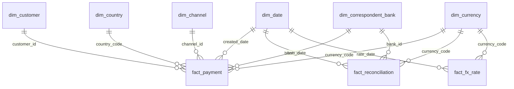

# Power BI — International Payments Analytics

> 🇪🇸 Cómo abrir y cómo está construido el reporte · 🇬🇧 How to open the report and how it is built

The report is saved as a **Power BI Project (`.pbip`)**: the semantic model is stored as TMDL and the report as PBIR (JSON), so every measure, relationship and visual can be reviewed in Git like code.

```
powerbi/
├── InternationalPayments.pbip              ← open this file in Power BI Desktop
├── InternationalPayments.SemanticModel/    ← model (TMDL): tables, relationships, 41 DAX measures
├── InternationalPayments.Report/           ← report (PBIR): 5 pages, custom theme
├── measures.dax                            ← readable copy of every measure
└── theme.json                              ← colour theme
```

## 1. Abrir el reporte / Open the report

1. Construye la base de datos / build the database: `..\scripts\build_database.ps1`.
2. Abre / open `InternationalPayments.pbip` in a recent version of Power BI Desktop (2025 or later).
3. Si tu servidor no es `localhost`: **Transform data → Edit parameters** → `SqlServer`, `SqlDatabase`.
4. Pulsa / click **Refresh**. La caché de datos no se sube a Git (`.pbi/cache.abf` está en `.gitignore`), así que la primera vez hay que actualizar / the data cache is not committed, so refresh once.

## 2. Modelo / Model



| Decisión / Design choice | Por qué / Why |
|---|---|
| Solo vistas `rpt` de SQL / only SQL `rpt` views | Las reglas de negocio (SLA, antigüedad, USD) viven en SQL, no se repiten en DAX |
| `dim_date` marcada como tabla de fechas, *auto date/time* desactivado | Inteligencia de tiempo correcta y modelo más liviano |
| Relación inactiva `settled_date` | Analizar por fecha de liquidación con `USERELATIONSHIP` |
| Tabla `_Measures` y carpetas de medidas | Medidas explícitas (`discourageImplicitMeasures`) y ordenadas por tema |
| Parámetros `SqlServer` / `SqlDatabase` | Cualquiera puede apuntar el reporte a su propio servidor |

## 3. Páginas / Pages

| # | Página / Page | Qué responde / What it answers |
|---|---|---|
| 1 | Executive overview | KPIs del año, valor mensual vs. año anterior, mezcla por tipo de pago, rentabilidad por segmento |
| 2 | Corridors & customers | Valor por país contraparte, top clientes, ticket promedio, flujo neto por región |
| 3 | Operations & SLA | SLA T+1 por corresponsal (semáforo), caída de CNY en ago–sep 2025, pico de rechazos de la app móvil |
| 4 | Reconciliation | Tasa de conciliación automática, excepciones por tipo y antigüedad, detalle por cuenta nostro |
| 5 | FX risk | Índice de monedas (base 100), volatilidad anualizada, variación anual y exposición no-USD |

Las capturas están en [`../docs/images/`](../docs/images/) / screenshots live in `docs/images/`.
